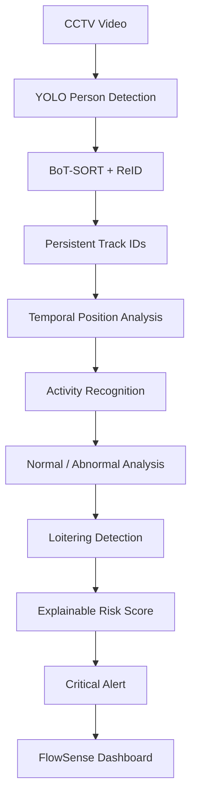
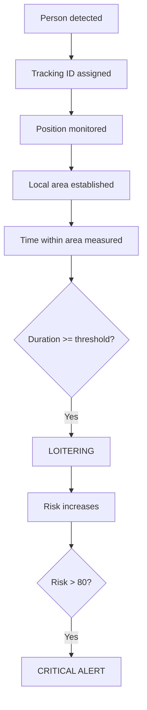
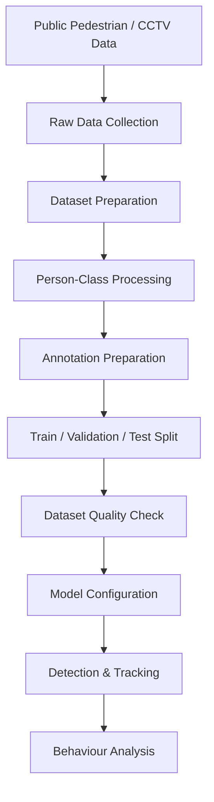

# FlowSense – Autonomous Behaviour Understanding

**Autonomous CCTV person detection, multi-person tracking, temporal behaviour analysis and explainable risk alerts using YOLO26s, BoT-SORT + ReID and pose-based activity recognition.**

A computer-vision system that turns raw CCTV video into explainable alerts: it detects people, gives each one a persistent ID, watches their behaviour over time, and raises a critical-risk alert with clear evidence (who, what, when, why).


[Overview](#project-overview) · [Getting Started](#getting-started) · [Architecture](#system-architecture) · [Behaviour Analysis](#behaviour-analysis) · [Dataset](#dataset) · [Results](#results-and-validation) · [Limitations](#limitations-and-future-improvements)

---

## Table of Contents

- [Project Overview](#project-overview)
- [At a Glance](#at-a-glance)
- [Project Background](#project-background)
- [Objectives](#objectives)
- [Key Features](#key-features)
- [Getting Started](#getting-started)
- [System Architecture](#system-architecture)
- [Detection and Tracking](#detection-and-tracking)
- [Behaviour Analysis](#behaviour-analysis)
- [Activity Recognition](#activity-recognition)
- [Explainable Risk Score](#explainable-risk-score)
- [Evidence and Explainability](#evidence-and-explainability)
- [Models](#models)
- [Dataset](#dataset)
- [Results and Validation](#results-and-validation)
- [Sample Input and Output](#sample-input-and-output)
- [Screenshots](#screenshots)
- [Demonstration Flow](#demonstration-flow)
- [Repository Structure](#repository-structure)
- [Technologies](#technologies)
- [Skills Demonstrated](#skills-demonstrated)
- [Scope: MVP and Stretch Goals](#scope-mvp-and-stretch-goals)
- [Limitations and Future Improvements](#limitations-and-future-improvements)
- [External Resources](#external-resources)
- [Author](#author)
- [License](#license)

---

## Project Overview

FlowSense is an autonomous CCTV vision and behaviour-understanding system. It processes CCTV video to:

- detect people,
- track them across frames with persistent IDs,
- analyse their position and movement over time,
- recognise basic activity (walking / standing),
- flag potentially abnormal behaviour (loitering),
- score the risk with a transparent, rule-based method, and
- generate a **CRITICAL ALERT** with timestamped evidence on a dashboard.

The project combines:

- Computer vision (person detection)
- Multi-object tracking with appearance-based ReID
- Pose-based activity analysis
- Temporal behaviour reasoning
- Deterministic, explainable risk scoring
- Alert generation and dashboard visualisation
- Public pedestrian / CCTV dataset preparation

Every alert can be explained: the system reports *who* (person ID), *what* (behaviour), *when* (timestamp and duration), *how risky* (score) and *why* (the configured threshold that was exceeded).

---

## At a Glance

| | |
|---|---|
| **Input** | CCTV / pedestrian video |
| **Detection** | YOLO26s (pretrained), `person` class |
| **Tracking** | BoT-SORT + ReID (appearance matching, not face recognition) |
| **Activity** | YOLO26s-Pose keypoints → `WALKING`, `STANDING` |
| **Behaviour** | `LOITERING` – prolonged presence in a local area (≥ 10 s) |
| **Risk score** | Starts at 60, rises with continued loitering, capped at 100 |
| **Critical alert** | Risk > 80 |
| **Dataset** | MOT17, MOT20, CrowdHuman → 39,296 image-label pairs |
| **Entry scripts** | `06_scripts/final_demo_critical.py`, `06_scripts/final_demo_pose.py` |
| **Status** | Working MVP |

---

## Project Background

FlowSense was developed for:

> **HNX26PSI07 – Autonomous Vision & Behaviour Understanding**

The problem asks for a system that can detect and track entities in video, understand behaviour over time, separate normal from unusual behaviour, and explain what happened with evidence. The table shows how FlowSense maps to each requirement:

| PS07 Requirement | FlowSense Implementation |
|---|---|
| Detect people / objects | YOLO-based person detection |
| Track entities | BoT-SORT + ReID |
| Persistent identity | Tracking IDs |
| Understand behaviour over time | Temporal spatial analysis |
| Normal vs unusual | Behaviour state classification |
| Identify entity | Person tracking ID |
| Identify when | Video timestamp and duration |
| Explain abnormal behaviour | Behaviour + duration + risk |
| Risk assessment | Deterministic risk score |
| Alert generation | Critical-risk signal |
| Evidence | ID, timestamp, duration and risk |

---

## Objectives

- Detect people in CCTV footage.
- Track multiple people and keep a persistent ID for each one.
- Analyse behaviour over several frames rather than from a single frame.
- Recognise basic activity states from body pose.
- Distinguish normal from potentially abnormal behaviour.
- Assign an explainable, rule-based risk score.
- Generate critical alerts that include evidence.
- Prepare a large, public pedestrian dataset for detection and tracking.
- Be transparent about what is implemented, what is experimental and what is planned.

---

## Key Features

**Perception**
- YOLO-based person detection.
- Multi-person tracking with BoT-SORT and ReID-based appearance matching.
- Persistent tracking IDs (for example `ID 1`, `ID 4`, `ID 15`, `ID 28`).

**Behaviour understanding**
- Temporal local-area analysis instead of single-frame decisions.
- `LOITERING` detection when a person stays in the configured area longer than the threshold.
- Pose-based `WALKING` / `STANDING` activity states.

**Explainability and alerting**
- Deterministic, rule-based risk score (0–100).
- `CRITICAL ALERT` when risk exceeds 80.
- Dashboard output with person ID, behaviour, activity, duration, risk and timestamp.

**Data**
- Dataset preparation scripts for MOT17, MOT20 and CrowdHuman.
- A prepared dataset of 39,296 image-label pairs with train / validation / test splits.

---

## Getting Started

### Requirements

| Requirement | Purpose |
|---|---|
| Python 3.11 | Run the project |
| Git | Clone the repository |
| Windows or Linux | Supported platforms |
| Sufficient storage and RAM | Video processing and models |

### Installation

```bash
# 1. Clone the repository
git clone https://github.com/pradee-26/FlowSense-Autonomous-Behaviour-Understanding.git
cd FlowSense-Autonomous-Behaviour-Understanding

# 2. Create a virtual environment
python -m venv venv

# 3. Activate it
venv\Scripts\activate          # Windows
source venv/bin/activate       # Linux

# 4. Install dependencies
pip install -r requirements.txt
```

### Run the system

| Goal | Command |
|---|---|
| Critical-alert demo (full dashboard) | `python 06_scripts/final_demo_critical.py` |
| Pose-based activity demo | `python 06_scripts/final_demo_pose.py` |

**Critical-alert demo.** Processes the configured CCTV video and generates the FlowSense behaviour dashboard: person detection, tracking IDs, activity, behaviour, risk score, abnormal-behaviour alerts, critical alerts and timestamps.

**Pose-based activity demo.** Combines YOLO26s-Pose, BoT-SORT + ReID and pose-keypoint analysis to estimate basic activity states.

### Configuration

Configuration files are in `05_configs/`:

| File | Purpose |
|---|---|
| `data.yaml` | Full dataset configuration |
| `data_small.yaml` | Small dataset configuration |
| `botsort_reid.yaml` | BoT-SORT + ReID tracker configuration |

The demonstration scripts contain settings for the input video, output video, loitering threshold, local-area radius, movement threshold and critical-risk threshold.

> **Note:** Paths in the scripts may need to be updated when running the project on another computer. Large datasets, model weights, checkpoints, generated results and videos are excluded from Git via `.gitignore`.

---

## System Architecture



| Stage | Technology | Output |
|---|---|---|
| Person detection | YOLO26s | Person bounding boxes |
| Tracking | BoT-SORT + ReID | Persistent track IDs |
| Temporal analysis | Position over time within a local area | Time spent in area |
| Activity recognition | YOLO26s-Pose keypoints | `WALKING` / `STANDING` |
| Behaviour analysis | Rule-based thresholds | `LOITERING` / normal |
| Risk scoring | Deterministic rules | Score 60–100 |
| Alerting | Threshold on risk | `CRITICAL ALERT` |
| Dashboard | OpenCV overlay | Annotated output video |

---

## Detection and Tracking

**Detection.** A pretrained YOLO26s model detects people in each frame. The current demonstration focuses on the `person` class.

**Tracking.** Detected people are linked across frames with **BoT-SORT**, assisted by **ReID** appearance features, so each person keeps a persistent ID. Tracker settings are in `05_configs/botsort_reid.yaml`. ByteTrack was evaluated during development.

> ReID is used only for tracking consistency. FlowSense does **not** perform facial recognition.

---

## Behaviour Analysis

FlowSense analyses a person's position over many frames. The current MVP focuses on **prolonged presence within a local spatial area**.

| Setting | Value |
|---|---|
| Local area | ≈ 5-metre equivalent (image-based approximation) |
| Loitering threshold | 10 seconds |

For every tracked person:



This gives a deterministic and explainable reasoning mechanism with no black-box decision.

> The 5-metre value is derived from image-space bounding-box information. The camera is not calibrated, so it is not a true physical distance.

---

## Activity Recognition

A pretrained **YOLO26s-Pose** model estimates basic activity from human keypoints such as knees and ankles.

| State | Meaning |
|---|---|
| `WALKING` | Person is moving |
| `STANDING` | Person is stationary |

More complex actions (for example falling, sitting or running) are listed under [stretch goals](#scope-mvp-and-stretch-goals).

---

## Explainable Risk Score

| Rule | Value |
|---|---|
| Initial risk when loitering is detected | 60 |
| Change with continued loitering | Increases |
| Maximum risk | 100 |
| Critical threshold | Risk > 80 |

When the threshold is crossed, FlowSense generates a critical-risk signal and the dashboard displays **CRITICAL ALERT**, including:

- Person ID
- Behaviour
- Activity
- Duration
- Risk score
- Timestamp

> The risk score is a rule-based assessment, **not** a probability of danger.

---

## Evidence and Explainability

Every alert carries the evidence needed to understand it:

```text
ID 15
Behaviour: LOITERING
Activity:  STANDING
Duration:  15.4 seconds
Risk:      81/100
Status:    CRITICAL
```

| Question | Answer |
|---|---|
| **WHO** | Person ID |
| **WHAT** | Behaviour |
| **WHEN** | Timestamp / duration |
| **RISK** | Risk score |
| **WHY** | Behaviour exceeded the configured temporal threshold |

---

## Models

| Model | Use |
|---|---|
| **YOLO26s** (pretrained) | Person detection and tracking in the final demonstration |
| **YOLO26s-Pose** (pretrained) | Keypoint-based activity analysis |
| **BoT-SORT + ReID** | Track maintenance and appearance-based association |
| **YOLO26n** (custom, experimental) | Small training run to validate the dataset-to-model pipeline |

---

## Dataset

FlowSense uses publicly available pedestrian / CCTV datasets:

- **MOT17**
- **MOT20**
- **CrowdHuman**

The prepared dataset contains **39,296 image-label pairs**:

| Split | Images |
|---|---|
| Training | 27,507 |
| Validation | 7,859 |
| Testing | 3,930 |

> The full dataset is not included in this repository because of its size. Download the public datasets from their original sources and run the preparation scripts.

### Data pipeline



### Preparation scripts (`06_scripts/`)

| Script | Purpose |
|---|---|
| `crowdhuman_prepare_person.py` | Prepare the person class from CrowdHuman |
| `mot17_prepare_person.py` | Prepare the person class from MOT17 |
| `mot20_prepare_person.py` | Prepare the person class from MOT20 |
| `fix_mot_labels.py` | Fix MOT label issues |
| `finalize_dataset.py` | Build the final train / validation / test dataset |

---

## Results and Validation

| Component | Status |
|---|---|
| Person detection | Working (pretrained YOLO26s) |
| Multi-person tracking with persistent IDs | Working (BoT-SORT + ReID) |
| Temporal loitering detection | Working |
| Walking / standing activity | Working (YOLO26s-Pose) |
| Risk scoring and critical alerts | Working |
| Dashboard with timestamped evidence | Working |
| Custom-trained detector | Experimental only |

### Experimental custom training

A small YOLO26n training run was performed to validate the dataset-to-model pipeline.

| Setting | Value |
|---|---|
| Training images | 100 |
| Validation images | 20 |
| Epochs | 1 |
| Device | CPU |

The pipeline completed successfully, but validation performance was low because the run used a very small dataset and only one epoch. For that reason the **pretrained YOLO26s** model is used in the final demonstration, as it gave more reliable detection and tracking. The experimental model is documented here so that it is not presented as a high-accuracy trained model.

### Evaluation note

The demonstration video has no verified ground-truth loitering annotations. Detected loitering events therefore represent **rule-based potential abnormal behaviour**, not verified real-world incidents.

---

## Sample Input and Output

**Input:** a CCTV-style pedestrian video with multiple people moving through a scene.

**Output:** a processed video showing:

- Person bounding boxes
- Tracking IDs
- Activity labels
- Behaviour labels
- Risk scores
- Abnormal-behaviour alerts
- Critical alerts
- Timestamps

```text
ID 15 | LOITERING
Activity: STANDING
Duration: 15.4s
Risk: 81/100
```

---

## Screenshots

<!--
Add screenshots to a Screenshots/ folder and uncomment:


-->

Screenshots of the tracking output, loitering detection and critical alert dashboard can be added to a `Screenshots/` folder and linked here.

---

## Demonstration Flow

1. Introduce FlowSense and the PS07 problem statement.
2. Show the pipeline: detection → tracking → behaviour analysis → risk → alert.
3. Run `python 06_scripts/final_demo_critical.py`.
4. Point out bounding boxes and persistent tracking IDs.
5. Show activity labels (`WALKING` / `STANDING`).
6. Show a person reaching `LOITERING` after 10 seconds.
7. Show the risk score rising and crossing 80.
8. Show the **CRITICAL ALERT** with ID, behaviour, activity, duration, risk and timestamp.
9. Run `python 06_scripts/final_demo_pose.py` to show pose-based activity analysis.
10. Explain the limitations and the planned extensions.

---

## Repository Structure

```text
FlowSense-Autonomous-Behaviour-Understanding/
│
├── 05_configs/
│   ├── botsort_reid.yaml
│   ├── data.yaml
│   └── data_small.yaml
│
├── 06_scripts/
│   ├── behavior_loitering.py
│   ├── crowdhuman_prepare_person.py
│   ├── final_demo.py
│   ├── final_demo_activity.py
│   ├── final_demo_critical.py
│   ├── final_demo_pose.py
│   ├── finalize_dataset.py
│   ├── fix_mot_labels.py
│   ├── mot17_prepare_person.py
│   └── mot20_prepare_person.py
│
├── README.md
├── requirements.txt
└── .gitignore
```

| Path | Purpose |
|---|---|
| `05_configs/` | Dataset and tracker configuration files |
| `06_scripts/` | Behaviour logic, demo scripts and dataset preparation scripts |
| `requirements.txt` | Python dependencies |
| `.gitignore` | Excludes datasets, weights, checkpoints, results and videos |

---

## Technologies

| Technology | Use in this project |
|---|---|
| Python 3.11 | Main language |
| OpenCV | Video I/O and dashboard overlays |
| NumPy, Pandas | Data handling |
| PyTorch, Torchvision | Deep-learning backend |
| Ultralytics | YOLO26s / YOLO26s-Pose and tracking |
| BoT-SORT + ReID | Multi-person tracking |
| YAML | Dataset and tracker configuration |
| Git and GitHub | Version control and hosting |

---

## Skills Demonstrated

- **Computer vision:** person detection and pose-based activity analysis.
- **Multi-object tracking:** BoT-SORT with ReID and persistent identities.
- **Temporal reasoning:** behaviour decisions based on movement over time.
- **Explainable AI:** deterministic rules with evidence for every alert.
- **Data engineering:** preparing MOT17, MOT20 and CrowdHuman into one train / validation / test dataset.
- **Model experimentation:** custom YOLO26n training and an honest comparison with pretrained models.
- **Responsible design:** no facial recognition, clear limitations and transparent reporting.
- **Technical documentation:** structured README with architecture, scope and limitations.

---

## Scope: MVP and Stretch Goals

### Implemented MVP

- CCTV video input
- Person detection
- BoT-SORT tracking with ReID-based assistance
- Persistent tracking IDs
- Temporal local-area analysis
- Loitering detection
- Walking / standing activity analysis
- Deterministic risk scoring
- Critical alerts
- Timestamped dashboard output

### Stretch goals (not implemented in the current MVP)

- Fall detection
- Sitting detection
- Running detection
- Restricted-zone intrusion
- Wrong-direction movement
- Crowding detection
- Multiple behaviour types
- General anomaly detection
- Camera calibration and true physical-distance measurement
- Advanced action recognition

---

## Limitations and Future Improvements

### Current limitations

- **Ground truth:** the demonstration video has no verified loitering annotations, so detected events are rule-based potential abnormal behaviour.
- **Distance:** the ≈ 5-metre local area is an image-based approximation; the camera is not geometrically calibrated.
- **Activity recognition:** limited to `WALKING` and `STANDING`; complex actions need more training and/or temporal action-recognition models.
- **Tracking:** BoT-SORT + ReID improves association but does not guarantee perfect identity persistence after every long disappearance or re-entry.
- **Behaviour coverage:** loitering is the only abnormal behaviour implemented.
- **Custom model:** the custom-trained detector is experimental (100 training images, 1 epoch, CPU) and is not used for the final results.
- **Portability:** file paths in the demo scripts may need editing on a new machine.
- **Privacy:** FlowSense uses person detection, tracking IDs and appearance-based ReID only. A tracking ID is a computational identity and does not represent a real-world identity.

### Possible future improvements

- Add more behaviours: fall, sitting, running, restricted-zone intrusion, wrong-direction movement and crowding.
- Calibrate the camera to measure true physical distance.
- Add a temporal action-recognition model for richer activities.
- Train the custom detector on the full prepared dataset for more epochs and compare it with the pretrained model.
- Evaluate on videos with verified ground-truth annotations and report quantitative metrics.
- Move hard-coded paths and thresholds into configuration files or command-line arguments.
- Add screenshots and a demonstration video link to this README.

---

## External Resources

**Datasets:** MOT17, MOT20, CrowdHuman, CCTV-style pedestrian video data

**Open-source frameworks:** Ultralytics, OpenCV, PyTorch

**Pretrained models:** YOLO26s, YOLO26s-Pose

**Tracking:** BoT-SORT, ReID-based appearance matching (ByteTrack was evaluated during development)

All significant external datasets, pretrained models and open-source components are declared here as required by the submission guidelines.

---

## Author

**PRADEEBA R S**

- GitHub: [@pradee-26](https://github.com/pradee-26)
- Repository: [pradee-26/FlowSense-Autonomous-Behaviour-Understanding](https://github.com/pradee-26/FlowSense-Autonomous-Behaviour-Understanding)

---

## License

No license has been selected for this repository yet, so reuse terms are not defined. To state reuse terms, add a `LICENSE` file at the repository root (on GitHub: **Add file → Create new file**, name it `LICENSE` and choose a template).

---

**FlowSense** · Computer Vision · Object Tracking · Behaviour Understanding · Explainable Alerts
